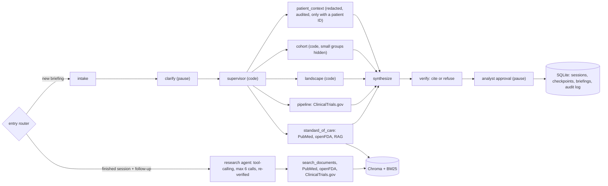

# Condition Briefing Agent (demo)

**Live demo:** https://shantomathew-condition-briefing.hf.space (passphrase-gated; hosted free on a Hugging Face Docker Space).

A web chat tool for a health system's strategy and planning team. An analyst types a condition (the demo uses
**dementia**), answers three clarifying questions, and gets a cited briefing in about 13 seconds on an idle machine:

- standard of care and approved products (PubMed, openFDA, internal documents),
- the treatment pipeline (ClinicalTrials.gov),
- key companies and institutions,
- de-identified statistics for our own patient panel, with small groups hidden,
- what our internal documents say (capacity, payer policy, referrals, workforce), and
- optional context for one patient, redacted, audited and labeled "clinician review required".

Every claim cites a PMID, an NCT ID, an FDA application number, or an internal document chunk
(`DOC:<doc_id>#<n>`). Claims that can't be tied to a source returned in the same run are dropped. The requester
approves or rejects each draft before it is marked final. After a briefing, follow-up questions in the same session
go to a research agent that answers from our documents and the public sources.

**Who it's for:** strategy analysts, service-line leaders and planning committees deciding where a health system
should invest (infusion capacity, memory clinic access, trial participation, payer readiness).
**Outcome:** a cited first draft in seconds instead of days of desk research, with every statement traceable.

> **Data notice.** All patient records and all Northlake Health documents in this repo are **synthetic**, made up
> for the demo. Northlake Health is fictional. Public data comes from PubMed, openFDA and ClinicalTrials.gov.
> This build is **not HIPAA compliant** and must not be used with real PHI.

Slides: [docs/PRESENTATION.md](docs/PRESENTATION.md) · Runbook: [docs/RUNBOOK.md](docs/RUNBOOK.md) ·
Monitoring: [docs/MONITORING.md](docs/MONITORING.md) ·
Security review: [docs/SECURITY-REVIEW.md](docs/SECURITY-REVIEW.md)

LangSmith ([project](https://smith.langchain.com/o/bae40cd1-5ffa-4bf9-ae8a-d69cfa97ca72/projects/p/2e192ab6-357b-4b00-8312-8493c6de2746)):
[golden](https://smith.langchain.com/o/bae40cd1-5ffa-4bf9-ae8a-d69cfa97ca72/datasets/1a9fcb49-099c-4a0e-aa36-11cd0cc33195/compare?selectedSessions=5ada4a71-802a-4a7f-9124-675dd7c217f8) ·
[unit](https://smith.langchain.com/o/bae40cd1-5ffa-4bf9-ae8a-d69cfa97ca72/datasets/c225a2db-5fc9-468b-800b-047717847128/compare?selectedSessions=11271fbf-7269-4c8d-ba45-56011f733c54) ·
[agentic](https://smith.langchain.com/o/bae40cd1-5ffa-4bf9-ae8a-d69cfa97ca72/datasets/e2a0bbd0-7a61-4356-b91c-27dfd1c5f76d/compare?selectedSessions=21cab288-96e8-41e1-a8f1-e7fca3b5b018) ·
[gold](https://smith.langchain.com/o/bae40cd1-5ffa-4bf9-ae8a-d69cfa97ca72/datasets/fabbb721-ad8d-42b8-99bd-dfa16145f763/compare?selectedSessions=2e79a143-8550-42a3-8e3c-7a369576ee10) ·
[RAG](https://smith.langchain.com/o/bae40cd1-5ffa-4bf9-ae8a-d69cfa97ca72/datasets/00873af8-7897-42d4-94d8-a4d1ba77c7c0/compare?selectedSessions=eaa4271b-f822-4d3d-8295-412a27d075d5) ·
[review queue](https://smith.langchain.com/o/bae40cd1-5ffa-4bf9-ae8a-d69cfa97ca72/annotation-queues/e697e70b-b44b-4859-b6cc-c24d7e0212e4)

## Quickstart

Requires Python 3.11+ (tested with 3.12).

```bash
git clone https://github.com/shanto12/condition-briefing-agent && cd condition-briefing-agent
python -m venv .venv && .venv/bin/pip install -r requirements-dev.txt

# Secrets: environment variables, else macOS Keychain (account = your login, or set KEYCHAIN_ACCOUNT)
export DEEPSEEK_API_KEY=...     # Keychain service codex-deepseek-interviews    (LLM)
export OPENAI_API_KEY=...       # codex-openai-interviews     (embeddings, eval judge)
export PINECONE_API_KEY=...     # codex-pinecone-interviews   (reranker; fallback embeddings)
export LANGSMITH_API_KEY=...    # codex-langsmith-personal-key (traces, feedback, experiments)

.venv/bin/python -m app.rag ingest                    # embed corpus/ into data/chroma/ (skips unchanged files)
.venv/bin/python -m app.rag search "infusion chairs"  # try retrieval
.venv/bin/python -m uvicorn app.main:app --port 8000  # open http://127.0.0.1:8000
```

API calls need an `X-User` header (the web page sets it). Main endpoints: `POST /api/chat`, `GET /api/sessions`,
`GET /api/sessions/{thread_id}`, `GET|POST /api/documents`, `GET /api/briefings`, `GET /api/audit`.

Config: `HEALTH_SYSTEM_STATE` (default Illinois), `COHORT_MIN_CELL` (default 3), `EMBED_PROVIDER`
(`openai` or `pinecone`), `RERANK` (`on`/`off`), `RETRIEVE_TOP_K` (default 5), `RERANK_MIN_SCORE` (default 0.3),
`BRIEFING_DATA_DIR`, and `BRIEFING_TRACING=off` to disable traces. Container instructions are in the runbook.

## Architecture



- **Orchestration: a code supervisor plus one tool-calling agent (LangGraph).** The briefing workflow is fixed, so
  a deterministic supervisor fans out to five parallel steps with `Send`. Each step makes one structured model call
  or runs plain code, which keeps it predictable and fast. Follow-up questions are open-ended, so that path is a real
  agent (`bind_tools`, at most 6 tool calls) that picks its own tools; its answer goes through the same citation
  check before it is shown.
- **Trust boundary.** `patient_context` is the only step that sees patient data, only after redaction, and only
  when a patient ID is given. The follow-up agent has no patient tools, its input contains only population-level
  sections, and it refuses patient-specific questions before any tool call.
- **Pauses (human in the loop).** LangGraph interrupts pause for the clarifying answers and for approval.
- **Model.** DeepSeek `deepseek-flash` through `langchain-deepseek`, thinking disabled, temperature 0,
  schema-locked (Pydantic) outputs.

### Documents and retrieval (RAG)

- **Corpus:** 20 synthetic Northlake Health documents in `corpus/`: 11 Markdown, 3 PDF, 3 Excel and 3 text files.
  Markdown carries its metadata in front matter; the other formats get theirs from `corpus/manifest.json`.
  `app/loaders.py` reads `.md`, `.txt`, `.pdf`, `.xlsx` and `.csv`, for the corpus and for uploads.
- **Ingestion:** heading-aware chunks; a PHI pattern screen and an injection filter run before any text leaves the
  machine; a content hash skips unchanged files. Vectors are stored in a persistent Chroma collection, one per
  embedding model.
- **Search:** OpenAI `text-embedding-3-large` dense top 20 plus BM25 top 20, merged with reciprocal rank fusion,
  reranked by Pinecone-hosted `bge-reranker-v2-m3` to the top 5. Below a rerank score of 0.3 the answer is "not in
  our documents".
- **Why the reranker:** on the 12-question retrieval set, recall@5 was 1.0 in every configuration, but without
  reranking neither embedding model refused the unanswerable question (its cosine score, 0.57, was higher than a
  real question's 0.52). Reranked, answerable questions scored at least 0.965 and the unanswerable one 0.18.
  `text-embedding-3-small` tied the large model on this corpus, which makes it a cost lever.
- **Mixed-format set** (`evals/retrieval_mixed.jsonl`, 13 questions): recall@5 1.0 and MRR 0.958 with rerank;
  without rerank recall@5 0.833. Unanswerable still refused.
- **If RAG is used:** the briefing says **Grounded in internal documents (N retrieved)** and lists `DOC:` citations
  under **Internal documents**.

### Memory, sessions and feedback

- Per-session state lives in LangGraph `SqliteSaver` checkpoints (`data/checkpoints.db`) plus a sessions table in
  `data/app.db`. Sessions survive a server restart and reopen from the sidebar or `?session=<thread_id>`.
- Sessions are owner-only: any other user gets a 404.
- There is no cross-session memory in v1 (privacy, stale facts).
- Every reply links to its LangSmith trace (project `live-build-interview`, through a client that redacts traced
  inputs and outputs). Approve and reject are recorded as `analyst_approval` feedback (1.0 / 0.0).

## Tests and evaluations

```bash
.venv/bin/python -m pytest -q                            # offline unit tests (fake model and embeddings)
.venv/bin/python -m evals.run_eval --offline             # deterministic guardrail checks (no LLM, no network)
.venv/bin/python -m evals.run_eval                       # plus 5 live end-to-end briefings
.venv/bin/python -m evals.run_eval --langsmith --experiment baseline   # same golden set as a LangSmith experiment
.venv/bin/python -m evals.run_retrieval_eval             # recall@5 and MRR: 3-large vs 3-small, rerank on/off
.venv/bin/python -m evals.run_rag_eval                   # uploads, search, DOC: citations, follow-up agent
.venv/bin/python -m evals.run_agentic_eval               # routing, step order, patient boundary, groundedness, latency
.venv/bin/python -m evals.gold.run_gold_eval             # reference answers scored with code checks and an OpenAI judge
```

With `LANGSMITH_API_KEY` set in the environment, pytest reports to LangSmith as well. `run_retrieval_eval` and
`run_rag_eval` upload with `--langsmith`; `run_agentic_eval` and the gold eval upload by default
(`run_agentic_eval --local` skips the upload).

| LangSmith dataset | Source | What it checks | Latest result |
|---|---|---|---|
| `condition-briefing-golden` | `evals/run_eval.py` (22 cases) | Scope, redaction, injection, cite-or-drop, audit, cohort, fallback, clarify, 5 live briefings | 92/92 checks ([baseline-89ae077d](https://smith.langchain.com/o/bae40cd1-5ffa-4bf9-ae8a-d69cfa97ca72/datasets/1a9fcb49-099c-4a0e-aa36-11cd0cc33195/compare?selectedSessions=5ada4a71-802a-4a7f-9124-675dd7c217f8)) |
| `condition-briefing-unit` | `tests/` (pytest) | Guardrails, graph, RAG, sources, store, API | 168 passed, 5 skipped, 0 failed ([90ad67c2](https://smith.langchain.com/o/bae40cd1-5ffa-4bf9-ae8a-d69cfa97ca72/datasets/c225a2db-5fc9-468b-800b-047717847128/compare?selectedSessions=11271fbf-7269-4c8d-ba45-56011f733c54)); both xfails fixed |
| `briefing-agentic-system` | `evals/agentic_cases.jsonl` | Routing, step order, patient boundary, citation validity, refusal, latency | 6/6, all scores 1.0 ([agentic-mvp-10af726a](https://smith.langchain.com/o/bae40cd1-5ffa-4bf9-ae8a-d69cfa97ca72/datasets/e2a0bbd0-7a61-4356-b91c-27dfd1c5f76d/compare?selectedSessions=21cab288-96e8-41e1-a8f1-e7fca3b5b018)) |
| `briefing-retrieval` | `evals/retrieval.jsonl` (12 questions) | Recall@5, MRR, refusing the unanswerable question | Recall@5 1.0; MRR 0.955 with rerank |
| `briefing-retrieval` (mixed) | `evals/retrieval_mixed.jsonl` (13 questions) | Same metrics on PDF / Excel / text | Recall@5 1.0; MRR 0.958 with rerank; 0.833 without |
| `briefing-gold-v1` | `evals/gold/gold_v1.jsonl` (20 cases) | Corpus Q&A, briefing facts, sponsor names, refusals | Correctness / refusal / sponsor / PHI all 1.0; key_fact 0.911; doc cited 0.923 ([gold-baseline-653354c0](https://smith.langchain.com/o/bae40cd1-5ffa-4bf9-ae8a-d69cfa97ca72/datasets/fabbb721-ad8d-42b8-99bd-dfa16145f763/compare?selectedSessions=2e79a143-8550-42a3-8e3c-7a369576ee10)) |
| `briefing-rag-followup` | `evals/rag_cases.jsonl` (6 cases) | Upload guardrails, search, `DOC:` citations, follow-up agent | 6/6 cases, 31/31 required ([rag-followup-80a8034a](https://smith.langchain.com/o/bae40cd1-5ffa-4bf9-ae8a-d69cfa97ca72/datasets/00873af8-7897-42d4-94d8-a4d1ba77c7c0/compare?selectedSessions=eaa4271b-f822-4d3d-8295-412a27d075d5)) |

- The two former xfails are fixed: "Should we start a memory clinic in the north region?" is allowed ("should we"
  refuses only when a patient ID or a drug/treatment word follows), and "alzheimers" without the apostrophe matches
  the Alzheimer's subtype. Pytest: 168 passed, 5 skipped, 0 failed.
- Agentic latency: p50 22.4 s. The p95 of 142.8 s came from 2 cold-start cases on a heavily loaded machine.

## Guardrails

- **Cite or refuse.** Every claim must cite a source returned in this run, of a type allowed for its section;
  fabricated or missing citations remove the claim, and the counts show in the briefing. The follow-up agent's
  answers go through the same check.
- **Scope refusal.** Diagnosis, prescribing and treatment-plan requests are refused before any work runs or any
  patient data is read. Strategy questions ("what treatment should our health system invest in?") are allowed.
- **PHI.** Patient records are de-identified before any model call; the LangSmith client masks direct identifiers
  in traces; every patient access is written to an append-only audit log (SQLite triggers block UPDATE and DELETE);
  cohort counts under 3 are hidden. Stored briefings and transcripts keep only the population view: no patient
  section, patient sources or patient IDs.
- **Untrusted text.** Patient notes, public API text and uploaded documents are treated as data. Sentences that look
  like instructions are removed and logged. Uploads are screened for PHI patterns before any text leaves the
  machine and rejected if one is found.
- **Resilience.** Public API responses are cached in `fixtures/` (git-ignored); during an outage the cache is
  served and the briefing is flagged as using stale sources.

## Security review

A manual review is in [docs/SECURITY-REVIEW.md](docs/SECURITY-REVIEW.md). The Aikido scan was not run because it
needs an interactive sign-in, so a manual secret scan ran instead.

- **Secrets and data:** no secrets in tracked files or git history, and no real PHI.
- **High (fixed):** stored briefings and transcripts kept patient links (`PATIENT:Pxxx`) that any user could read.
  They now store a population view with typed patient IDs masked; verified on a new briefing.
- **Deferred to v2 (Medium):** the audit log is readable by every user; upload size is checked after the request is
  read; the PHI screen is regex-only; approval is the requester's own sign-off; identity is a header and must become
  SSO.
- **Eval harness:** inside LangSmith `evaluate()`, LangChain adds a tracer that bypasses our redaction, so the
  agentic eval runs app calls with tracing off.

## Known limits (not production)

- **Not HIPAA compliant.** Synthetic patients and documents only.
- **DeepSeek has no business associate agreement (BAA).** Real PHI needs a BAA-covered endpoint (Azure OpenAI,
  AWS Bedrock, or the OpenAI API under a BAA with zero data retention), or a self-hosted model.
- **Identity is a header.** `X-User` stands in for SSO (OIDC with role claims); bind to 127.0.0.1 until then.
- **Approval is self-approval.** The requester signs off their own draft; production needs a separate reviewer role.
- **Uploads are shared.** An uploaded document can be retrieved in every user's briefings.
- **Regex screens.** PHI, scope and injection checks are pattern-based and miss paraphrases.
- **Claim support.** At runtime the verifier checks that each citation exists and fits the section. Whether the
  cited text actually supports the claim is measured offline by the eval judge, not enforced on every briefing.
- **Docker.** The `Dockerfile` (non-root, healthcheck, ingest on start) has not been built: Docker isn't installed
  on the build machine.
