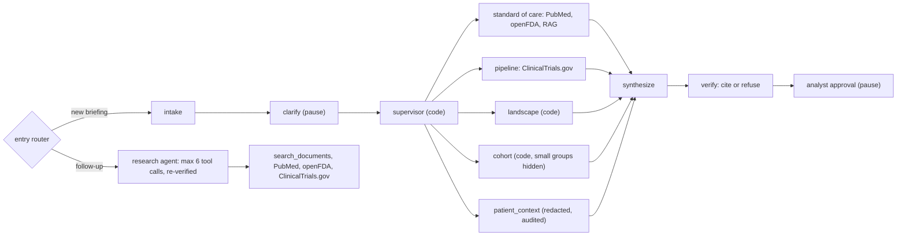

# Condition Briefing Agent

Cited condition briefings for a health system's strategy team. Built live in one session.
Demo condition: dementia. **All patient data and Northlake Health documents are synthetic.**

- Repo: [shanto12/condition-briefing-agent](https://github.com/shanto12/condition-briefing-agent) (commit `7dc1971`)
- LangSmith: [golden](https://smith.langchain.com/o/bae40cd1-5ffa-4bf9-ae8a-d69cfa97ca72/datasets/1a9fcb49-099c-4a0e-aa36-11cd0cc33195/compare?selectedSessions=5ada4a71-802a-4a7f-9124-675dd7c217f8) ·
  [unit](https://smith.langchain.com/o/bae40cd1-5ffa-4bf9-ae8a-d69cfa97ca72/datasets/c225a2db-5fc9-468b-800b-047717847128/compare?selectedSessions=11271fbf-7269-4c8d-ba45-56011f733c54) ·
  [agentic](https://smith.langchain.com/o/bae40cd1-5ffa-4bf9-ae8a-d69cfa97ca72/datasets/e2a0bbd0-7a61-4356-b91c-27dfd1c5f76d/compare?selectedSessions=21cab288-96e8-41e1-a8f1-e7fca3b5b018) ·
  [gold](https://smith.langchain.com/o/bae40cd1-5ffa-4bf9-ae8a-d69cfa97ca72/datasets/fabbb721-ad8d-42b8-99bd-dfa16145f763/compare?selectedSessions=2e79a143-8550-42a3-8e3c-7a369576ee10) ·
  [RAG](https://smith.langchain.com/o/bae40cd1-5ffa-4bf9-ae8a-d69cfa97ca72/datasets/00873af8-7897-42d4-94d8-a4d1ba77c7c0/compare?selectedSessions=eaa4271b-f822-4d3d-8295-412a27d075d5) ·
  [review queue](https://smith.langchain.com/o/bae40cd1-5ffa-4bf9-ae8a-d69cfa97ca72/annotation-queues/e697e70b-b44b-4859-b6cc-c24d7e0212e4) ·
  [project](https://smith.langchain.com/o/bae40cd1-5ffa-4bf9-ae8a-d69cfa97ca72/projects/p/2e192ab6-357b-4b00-8312-8493c6de2746)

---

## 1. A strategy team needs a cited briefing before it commits to a service line

- **User:** a strategy analyst on the health system's planning team. **Decision-maker:** the planning committee
  deciding a service-line investment, for example an anti-amyloid infusion program for dementia.
- **Today:** days of desk research across guidelines, FDA approvals, trial pipelines, payer rules and our own
  capacity data, and the sources are hard to trace afterwards.
- **Outcome:** a cited first draft in about 13 seconds; an analyst reviews and approves it before it is final.
- **"Wrong" means:** a claim with no source, an outdated trial status, or a misnamed sponsor.
- **Out of scope:** clinical advice. The tool refuses to diagnose, prescribe or write treatment plans.

> **Say:** In healthcare every number in a board memo has to be traceable, so cite-or-refuse is the core
> requirement, not a nice-to-have.

---

## 2. MVP scope: one condition, end to end, every layer thin

- **Discovery answers that shaped it:** users on the healthcare team, web chat, about 5 runs a day, input is a
  condition, PHI must be protected, a patient history tool, SQLite with resumable sessions, LangSmith.
- **In:** three clarifying questions, a parallel briefing, analyst approval, follow-up questions, document upload,
  resumable sessions, traces and feedback, six eval suites.
- **Data:** PubMed, openFDA and ClinicalTrials.gov (public), 20 synthetic internal documents, a synthetic
  10-patient panel.
- **Cut on purpose:** EHR integration, SSO, multi-condition comparison, a model router, a runtime claim-support
  judge, Postgres, a built Docker image.

> **Say:** A thin slice of every layer (model, retrieval, memory, guardrails, evals, deploy path) beats a deep
> slice of one.

---

## 3. Architecture: code supervisor, parallel steps, one agent

- **Deterministic supervisor + LangGraph `Send`:** the briefing steps never change, so code routing is
  predictable, testable and parallel.
- **One tool-calling agent, only where the question is open-ended:** follow-ups. No patient tools; its answer goes
  through the same citation check.
- **Trust boundary:** only `patient_context` sees patient data, redacted, audited, and only when a patient ID is given.
- **Alternatives:** a single ReAct agent is slower and harder to evaluate; CrewAI is fast to stand up but weaker on
  explicit state and pauses; AutoGen is in maintenance mode. LangGraph gives state, checkpoints and interrupts.

> **Say:** Start with one agent and add autonomy only where the job is truly open-ended.

---

## 4. RAG: the reranker is what makes "not in our documents" work

- **Corpus:** 20 synthetic Northlake Health documents: 11 Markdown, 3 PDF, 3 Excel, 3 text. PHI and injection
  screening runs before any text leaves the machine.
- **Pipeline:** Chroma + OpenAI `text-embedding-3-large` (the client's choice; local models were ruled out by the
  machine) + BM25, merged with reciprocal rank fusion, then Pinecone `bge-reranker-v2-m3` to the top 5.
  Citations look like `DOC:<doc_id>#<n>`.
- **If RAG is used:** the briefing says **Grounded in internal documents (N retrieved)** and lists those `DOC:`
  citations under **Internal documents**.

| Retrieval eval, 12 questions | Recall@5 | MRR | Refuses the unanswerable one |
|---|---|---|---|
| 3-large + rerank | 1.0 | 0.955 | yes |
| 3-large, no rerank | 1.0 | 0.932 | no |
| 3-small + rerank | 1.0 | 0.955 | yes |
| 3-small, no rerank | 1.0 | 0.939 | no |

- **Why the reranker:** by cosine score the unanswerable question (0.57) looked more relevant than a real one (0.52).
  Reranked scores separate them: answerable at least 0.965, unanswerable 0.18, cutoff 0.3.
- **Mixed-format set (13 questions):** recall@5 1.0, MRR 0.958 with rerank; without rerank recall@5 0.833. Large and
  small embeddings still tie, so small is the cost lever.

> **Say:** The reranker isn't there to reorder results; it's there so the system can say "not in our documents".

---

## 5. Guardrails and PHI: cite or refuse, minimum necessary

- **Cite or refuse:** every claim must cite a source returned in this run, of a type allowed in its section, or it
  is dropped. Smoke run: the verifier kept 42 of 42 claims, 10 of them citing internal documents.
- **Scope:** diagnosis, prescribing and treatment-plan requests are refused before any work runs; patient questions
  to the follow-up agent are refused before any tool call.
- **PHI:** de-identified before any model call; a redacting LangSmith client; every patient access is in an
  append-only audit log; stored briefings and transcripts keep only the population view.
- **Untrusted text:** injected instructions in notes, API text and uploads are removed and logged.
- **Compliance:** synthetic data only and no HIPAA claim. DeepSeek has no BAA, so real PHI needs a BAA-covered
  endpoint (Azure OpenAI, Bedrock, or OpenAI under a BAA with zero retention).

> **Say:** The PHI screen is pattern-based: a guardrail, not a guarantee. That's why production needs a BAA
> endpoint and SSO, not just better regexes.

---

## 6. Memory and sessions: one checkpoint per session, owner only

- **State:** LangGraph `SqliteSaver` checkpoints plus a sessions table. Sessions resume after a server restart.
- **Ownership:** another user asking for the session gets a 404.
- **No cross-session memory in v1:** avoids privacy leaks and stale facts. Knowledge lives in the vector store;
  workflow state never lives in embeddings.
- **Feedback loop:** every reply links to its LangSmith trace; approve/reject is recorded as `analyst_approval`
  feedback (1.0 / 0.0), so the override rate becomes the quality signal.
- **Production:** Postgres checkpointer and a retention/purge job.

> **Say:** Memory is boring on purpose: a checkpoint per session, keyed to the user.

---

## 7. Evaluation: every suite is a LangSmith dataset

- **Scorers:** code for exact checks; an OpenAI judge (a different model family from the DeepSeek generator) for
  fuzzy answers; analysts for a sample in production.

| Suite | Dataset / experiment | Result |
|---|---|---|
| Golden behavior | `condition-briefing-golden` / [baseline-89ae077d](https://smith.langchain.com/o/bae40cd1-5ffa-4bf9-ae8a-d69cfa97ca72/datasets/1a9fcb49-099c-4a0e-aa36-11cd0cc33195/compare?selectedSessions=5ada4a71-802a-4a7f-9124-675dd7c217f8) | 92/92 checks; grounded, PHI-safe, scope all 1.0 |
| Unit tests (pytest) | `condition-briefing-unit` / [90ad67c2](https://smith.langchain.com/o/bae40cd1-5ffa-4bf9-ae8a-d69cfa97ca72/datasets/c225a2db-5fc9-468b-800b-047717847128/compare?selectedSessions=11271fbf-7269-4c8d-ba45-56011f733c54) | 168 passed, 5 skipped, 0 failed |
| Agentic system | `briefing-agentic-system` / [agentic-mvp-10af726a](https://smith.langchain.com/o/bae40cd1-5ffa-4bf9-ae8a-d69cfa97ca72/datasets/e2a0bbd0-7a61-4356-b91c-27dfd1c5f76d/compare?selectedSessions=21cab288-96e8-41e1-a8f1-e7fca3b5b018) | 6/6; routing, step order, patient boundary, citations, refusal all 1.0 |
| Retrieval | `evals/retrieval.jsonl` (12 questions) | recall@5 1.0; MRR 0.955 with rerank |
| Retrieval (mixed) | `evals/retrieval_mixed.jsonl` (13 questions) | recall@5 1.0; MRR 0.958 with rerank; 0.833 without |
| Gold reference | `briefing-gold-v1` / [gold-baseline-653354c0](https://smith.langchain.com/o/bae40cd1-5ffa-4bf9-ae8a-d69cfa97ca72/datasets/fabbb721-ad8d-42b8-99bd-dfa16145f763/compare?selectedSessions=2e79a143-8550-42a3-8e3c-7a369576ee10) | 20 cases; correctness / refusal / sponsor / PHI all 1.0; key_fact 0.911; doc cited 0.923 |
| RAG + follow-up | `briefing-rag-followup` / [rag-followup-80a8034a](https://smith.langchain.com/o/bae40cd1-5ffa-4bf9-ae8a-d69cfa97ca72/datasets/00873af8-7897-42d4-94d8-a4d1ba77c7c0/compare?selectedSessions=eaa4271b-f822-4d3d-8295-412a27d075d5) | 6/6 cases, 31/31 required checks |

- **Latency:** agentic run p50 22.4 s; the p95 of 142.8 s came from 2 cold-start cases on a heavily loaded machine.
  On an idle machine a briefing takes about 13 s.

> **Say:** Each agent is tested alone and the full path end to end, and every result is one click from its trace.

---

## 8. What the evals caught: every failure becomes a test

| Caught by | Problem | Before | After |
|---|---|---|---|
| Golden set | "What treatment should our health system invest in?" refused as clinical | scope 31/32 | 32/32 (narrower rule) |
| Golden set | API replied `done` instead of `final` after approval | 88/92 | 92/92 (assert stored status) |
| pytest | "Should we start a memory clinic…" refused as clinical | strict xfail | allowed; "should we" refuses only with a patient ID or drug/treatment word (168 passed / 5 skipped) |
| pytest | "alzheimers" without the apostrophe didn't match the subtype | strict xfail | now matches Alzheimer's |
| Security review | Stored briefings kept `PATIENT:Pxxx` links any user could read (High) | open | fixed, verified on a new briefing |
| Gold set | Alzheimer's briefing omitted donepezil | key_fact 0.667 on that case | still open |
| Gold set | Injection-stripped follow-up skipped retrieval (expected 86% / `DOC:infusion-capacity`) | cited 0 | still open |

- **Harness lesson:** inside LangSmith `evaluate()`, LangChain added a tracer that skipped our redaction, so app
  calls in the eval run with tracing off (`tracing_context(enabled=False)`).
- **Pattern:** the scope rule failed twice on strategy questions. Guardrails need allow cases, not just block cases.

> **Say:** Two of the catches were the same weak spot, the regex scope rule, so that is the first thing I'd replace.

---

## 9. Path to production

- **Rollout:** shadow mode with 2-3 analysts, then canary, then general release; the analyst override rate is the
  main quality signal.
- **Monitoring:** online evals on a 5-10% sample of traces; alerts on error rate, p95 latency, cost per briefing,
  rejection rate and stale-source rate.
- **Caps:** 6 tool calls per follow-up, recursion limit, request timeouts, a cost cap per run, a fallback model,
  cached public data during outages.
- **Platform:** SSO (OIDC) with a separate reviewer role, Postgres checkpointer, managed vector DB behind the same
  retriever interface, BAA-covered model endpoint, secrets from a vault.
- **Deploy:** Dockerfile (non-root, healthcheck, ingest on start) and a runbook are ready; the image was not built
  here because this machine has no Docker.

> **Say:** Nothing writes to a system of record without a human approval, and that stays true in production.

---

## 10. Risks and mitigations

| Risk | Mitigation |
|---|---|
| Regex PHI, scope and injection screens miss paraphrases (3 of 4 paraphrased injections passed in review) | Classifier evaluated on the golden set; BAA endpoint so a miss isn't a breach |
| Uploads are shared, so one bad document can reach every briefing | Retrieve from the reviewed corpus only until an upload is approved |
| Public sources drift (trial status, sponsors) | Fetch live on each run, flag cached data as stale, re-run evals on drift |
| Header identity and self-approval | SSO with a reviewer role; block approver = requester |
| Latency under load (p95 142.8 s) | Async jobs, per-run caps, warm workers |

> **Say:** The biggest real risk is the pattern-based screens. I wouldn't point this at real PHI without the BAA
> endpoint and SSO.

---

## 11. Demo script

1. Type **dementia**, answer "Alzheimer's, service-line, P007", and open the trace link.
2. Point at **Grounded in internal documents (N retrieved)**, the **Internal documents** group of `DOC:` citations
   (infusion capacity), and the verification counts.
3. Follow-up: "What does the payer policy require?" gets a cited answer; "How many pediatric oncology beds?" gets
   "not in our documents".
4. P007 patient context: redacted, labeled, injected instruction removed, audit entry; a patient question to the
   agent is refused.
5. Restart the server, reopen the session from the sidebar, approve, and show `analyst_approval` in LangSmith.

> **Say:** If a public API is slow, the cached copy is served and the briefing is flagged as stale; the eval
> experiments are open in tabs as backup.

---

## 12. Next steps

1. **Replace the regex scope rule** with a small classifier evaluated on the golden and gold sets.
2. **Runtime claim-support check:** move the eval-time judge into `verify` for a sample of claims, calibrated
   against analyst labels.
3. **Shadow mode** with 2-3 analysts for two weeks, then SSO, a BAA endpoint, Postgres and a HIPAA review before
   any real PHI.

> **Say:** Each step is measured on the same datasets, so we'll know whether it helped.
